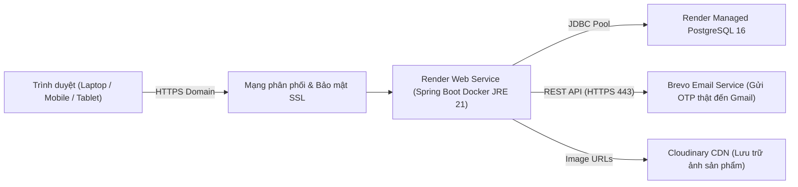

# HƯỚNG DẪN TRIỂN KHAI VÀ SỬ DỤNG HỆ THỐNG LUNEA
## Nền Tảng Website Mỹ Phẩm Chuỗi Cửa Hàng (Triển Khai Nền Tảng Cloud Render)

---

## MỤC LỤC
1. [Tổng quan dự án & Kiến trúc Cloud](#1-tổng-quan-dự-án--kiến-trúc-cloud)
2. [Truy cập & Sử dụng trực tiếp trên Render (Môi trường Live)](#2-truy-cập--sử-dụng-trực-tiếp-trên-render-môi-trường-live)
3. [Quy trình Triển khai lên Render từ GitHub (Deployment Guide)](#3-quy-trình-triển-khai-lên-render-từ-github-deployment-guide)
   - [3.1. Tạo Cơ sở dữ liệu Cloud (Render PostgreSQL)](#31-tạo-cơ-sở-dữ-liệu-cloud-render-postgresql)
   - [3.2. Tạo Web Service Docker trên Render](#32-tạo-web-service-docker-trên-render)
   - [3.3. Danh sách Biến môi trường (Environment Variables)](#33-danh-sách-biến-môi-trường-environment-variables)
   - [3.4. Kỹ thuật tối ưu hóa RAM 512MB & Chống OOM (Exit Code 137)](#34-kỹ-thuật-tối-ưu-hóa-ram-512mb--chống-oom-exit-code-137)
4. [Danh sách Tài khoản Thử nghiệm trên Bản Live (Demo Accounts)](#4-danh-sách-tài-khoản-thử-nghiệm-trên-bản-live-demo-accounts)
5. [Hướng dẫn sử dụng các phân hệ (User Guide)](#5-hướng-dẫn-sử-dụng-các-phân-hệ-user-guide)
   - [5.1. Dành cho Khách hàng (Storefront)](#51-dành-cho-khách-hàng-storefront)
   - [5.2. Dành cho Quản trị viên & Nhân viên Chi nhánh (Back-office)](#52-dành-cho-quản-trị-viên--nhân-viên-chi-nhánh-back-office)
6. [Kịch bản 16 Bước Demo Bảo vệ Đồ án Trực tiếp trên Cloud](#6-kịch-bản-16-bước-demo-bảo-vệ-đồ-án-trực-tiếp-trên-cloud)
7. [Phần Phụ trợ: Khởi chạy Cục bộ cho Lập trình viên (Local Development)](#7-phần-phụ-trợ-khởi-chạy-cục-bộ-cho-lập-trình-viên-local-development)
   - [7.1. Chạy với Docker Compose PostgreSQL](#71-chạy-với-docker-compose-postgresql)
   - [7.2. Chạy với Microsoft SQL Server](#72-chạy-với-microsoft-sql-server)
   - [7.3. Chạy kiểm thử tự động (163/163 Tests PASS)](#73-chạy-kiểm-thử-tự-động-163163-tests-pass)
8. [Xử lý sự cố & Câu hỏi thường gặp (Troubleshooting / FAQ)](#8-xử-lý-sự-cố--câu-hỏi-thường-gặp-troubleshooting--faq)

---

## 1. TỔNG QUAN DỰ ÁN & KIẾN TRÚC CLOUD

**LUNEA** là hệ thống thương mại điện tử kết hợp quản lý chuỗi showroom mỹ phẩm. Toàn bộ dự án đã được tối ưu hóa và **triển khai hoàn chỉnh lên hạ tầng điện toán đám mây (Cloud PaaS Render)** theo tiêu chuẩn công nghiệp:



### Điểm nổi bật của bản Cloud Production:
- **Tên miền HTTPS bảo mật:** Cookie xác thực JWT `LUNEA_AT` thiết lập cờ `HttpOnly`, `SameSite=Lax` và `Secure=true`.
- **Cơ sở dữ liệu đám mây độc lập:** Dữ liệu tồn kho đa chi nhánh, tài khoản và đơn hàng được lưu trên Managed PostgreSQL.
- **Tự động khởi tạo dữ liệu (Auto Seeding):** Khi deploy, hệ thống tự động nhận diện và nạp sẵn 3 chi nhánh, 5 thương hiệu, sản phẩm phong phú, voucher và 5 tài khoản demo đầy đủ vai trò.
- **Gửi Email OTP thật:** Khách hàng đăng ký hoặc quên mật khẩu sẽ nhận được email chứa mã OTP thật trực tiếp trong hòm thư Gmail thông qua Brevo REST API.

---

## 2. TRUY CẬP & SỬ DỤNG TRỰC TIẾP TRÊN RENDER (MÔI TRƯỜNG LIVE)

Người chấm điểm / Giảng viên có thể truy cập và trải nghiệm hệ thống ngay trên mọi thiết bị (không cần cài đặt phần mềm):

* **Đường dẫn Web Khách hàng (Storefront):** `https://<ten-ung-dung-cua-ban>.onrender.com/`
* **Đường dẫn Trang Đăng nhập:** `https://<ten-ung-dung-cua-ban>.onrender.com/login`
* **Đường dẫn Quản trị Hệ thống (Admin & Staff):** `https://<ten-ung-dung-cua-ban>.onrender.com/admin`

*(Lưu ý: Nếu sử dụng gói Free của Render, server sẽ chuyển sang chế độ ngủ (Sleep) khi không có truy cập trong 15 phút. Lần truy cập đầu tiên có thể mất khoảng 30–50 giây để container thức dậy (Cold Start). Sau khi đã bật, web phản hồi cực kỳ nhanh).*

---

## 3. QUY TRÌNH TRIỂN KHAI LÊN RENDER TỪ GITHUB (DEPLOYMENT GUIDE)

Dự án được kết nối tự động với kho mã nguồn GitHub:  
`https://github.com/nhatnguyen10a1thd-png/CNPM`

### 3.1. Tạo Cơ sở dữ liệu Cloud (Render PostgreSQL)
1. Đăng nhập vào [Dashboard Render](https://dashboard.render.com/).
2. Chọn **New +** ➔ **PostgreSQL**.
3. Điền thông tin:
   - **Name:** `lunea-db`
   - **Database:** `lunea`
   - **User:** `lunea`
   - **Region:** Singapore (Southeast Asia) để tối ưu độ trễ mạng về Việt Nam.
   - **Plan:** Free.
4. Bấm **Create Database**. Sau khi tạo xong, copy mục **Internal Database URL** (hoặc External Database URL).

### 3.2. Tạo Web Service Docker trên Render
1. Trên Render Dashboard, chọn **New +** ➔ **Web Service**.
2. Chọn kho lưu trữ GitHub của dự án: `nhatnguyen10a1thd-png/CNPM`.
3. Cấu hình dịch vụ:
   - **Name:** `lunea-cosmetics`
   - **Region:** Singapore
   - **Language:** **Docker** *(Render sẽ tự động đọc file `Dockerfile` có sẵn trong root)*.
   - **Instance Type:** Free (512 MB RAM, 0.5 CPU).

### 3.3. Danh sách Biến môi trường (Environment Variables)
Tại mục **Environment Variables** của Web Service, cấu hình các giá trị sau:

| Key (Tên biến) | Value (Giá trị) | Mục đích |
|---|---|---|
| `SPRING_DATASOURCE_URL` | `jdbc:postgresql://<host-db>:5432/lunea` | Kết nối tới database PostgreSQL đám mây |
| `SPRING_DATASOURCE_USERNAME` | `lunea` | Tên đăng nhập database |
| `SPRING_DATASOURCE_PASSWORD` | `<mat-khau-database-do-render-cap>` | Mật khẩu database |
| `SPRING_DATASOURCE_DRIVER_CLASS_NAME` | `org.postgresql.Driver` | Driver PostgreSQL |
| `SPRING_JPA_DIALECT` | `org.hibernate.dialect.PostgreSQLDialect` | Dialect Hibernate chuẩn |
| `SPRING_JPA_HIBERNATE_DDL_AUTO` | `update` | Tự động sinh bảng và nạp dữ liệu lần đầu |
| `COOKIE_SECURE` | `true` | Bật cờ Secure cho cookie JWT trên HTTPS |
| `BREVO_API_KEY` | `<your-brevo-api-key>` | Key gửi mã OTP qua email Gmail thật |
| `BREVO_SENDER_EMAIL` | `nhatnguyen10a1thd@gmail.com` | Email đã xác thực làm người gửi |

Bấm **Save Changes**. Render sẽ tự động kéo mã nguồn, kích hoạt Docker build và đưa website lên live sau 2–3 phút!

### 3.4. Kỹ thuật tối ưu hóa RAM 512MB & Chống OOM (Exit Code 137)
Các ứng dụng Java Spring Boot thông thường chạy trên container rất dễ bị Render kill vì vượt quá 512MB RAM. Dự án đã xử lý triệt để vấn đề này tại [Dockerfile](file:///c:/Users/nhatn/OneDrive/Desktop/lunea/CNPM/Dockerfile):
1. **Multi-stage build:** Biên dịch bằng Maven SDK ở Stage 1, sau đó chỉ copy file JAR sang Stage 2 chạy trên nền JRE Alpine siêu nhẹ (`eclipse-temurin:21-jre-alpine` chỉ ~180MB).
2. **JVM Memory Tuning:**
   ```dockerfile
   ENV JAVA_OPTS="-Xmx350m -Xms128m -Xss512k -XX:+UseSerialGC -Dfile.encoding=UTF-8"
   ```
   - `-Xmx350m`: Khống chế bộ nhớ Heap tối đa 350MB (dành ra 162MB cho JRE và Linux OS).
   - `-Xms128m`: Khởi động nhẹ nhàng với 128MB.
   - `-Xss512k`: Thu nhỏ kích thước stack thread từ 1MB xuống 512KB.
   - `-XX:+UseSerialGC`: Trình dọn rác đơn luồng nhẹ nhất, không ngốn CPU/RAM của container.

---

## 4. DANH SÁCH TÀI KHOẢN THỬ NGHIỆM TRÊN BẢN LIVE (DEMO ACCOUNTS)

Hệ thống đã nạp sẵn 5 tài khoản demo đại diện cho các vai trò khác nhau trong mô hình chuỗi cửa hàng.  
*(Tất cả đều dùng chung mật khẩu: **`123456`**)*

| Nhóm người dùng | Tên đăng nhập | Mật khẩu | Quyền hạn & Phạm vi chi nhánh |
|---|---|:---:|---|
| **Quản trị viên (Admin)** | `admin` | `123456` | Toàn quyền kiểm soát toàn chuỗi showroom, nhân sự, sản phẩm, kho, voucher |
| **Nhân viên Đơn hàng HCM** | `order_hcm` | `123456` | Chỉ quản lý và xử lý đơn hàng của **Chi nhánh Quận 1 - TP.HCM** |
| **Nhân viên Đơn hàng Hà Nội** | `order_hn` | `123456` | Chỉ quản lý và xử lý đơn hàng của **Chi nhánh Cầu Giấy - Hà Nội** |
| **Thủ kho chi nhánh HCM** | `warehouse_hcm` | `123456` | Quản lý kiểm kê, điều chỉnh tồn kho chi nhánh TP.HCM |
| **Khách hàng thân thiết** | `khach01` *(hoặc `0901234567`)* | `123456` | Khách hàng **Lê Hoàng Yến**, đã lưu sẵn sổ địa chỉ tại Q1, TP.HCM |

> 💡 **Tính năng Fast-Login:** Tại màn hình đăng nhập (`/login`), có sẵn danh sách các nút bấm **"Chọn nhanh tài khoản Demo"**. Bạn chỉ cần bấm 1 click là form tự động điền tài khoản tương ứng.

---

## 5. HƯỚNG DẪN SỬ DỤNG CÁC PHÂN HỆ (USER GUIDE)

### 5.1. Dành cho Khách hàng (Storefront)
1. **Tìm kiếm & Bộ lọc (`/products`):**
   - Tìm kiếm theo từ khóa: `Cocoon`, `Serum`, `Innisfree`,...
   - Lọc sản phẩm theo Thương hiệu, Danh mục, Khoảng giá, và đặc biệt là **Loại da** (Da dầu, Da khô, Nhạy cảm) hoặc **Nhu cầu** (Trị mụn, Phục hồi da).
2. **Chi tiết sản phẩm & Tra cứu tồn showroom (`/products/{id}`):**
   - Chọn đổi biến thể dung tích (SKU) để thấy giá tiền và giá niêm yết thay đổi.
   - Bấm nút **"Kiểm tra tình trạng còn hàng tại các showroom"** để xem chi nhánh nào còn hàng và số lượng khả dụng.
3. **Thanh toán & Mã giảm giá (`/checkout`):**
   - Tự động điền địa chỉ người nhận từ Sổ địa chỉ.
   - Nhập mã ưu đãi: `LUNEA10` (giảm 10%), `GIAM50K` (giảm 50.000đ), hoặc `FREESHIP` (miễn phí ship).
   - Đặt hàng thanh toán khi nhận hàng (COD).
4. **Quản lý đơn hàng & Hủy đơn (`/account/orders`):**
   - Theo dõi trạng thái đơn hàng theo thời gian thực.
   - Bấm nút **"Hủy đơn hàng"** khi đơn còn chờ duyệt ➔ Hệ thống lập tức hoàn trả số lượng hàng bị giữ về kho khả dụng của chi nhánh.
5. **Gửi đánh giá:** Đánh giá số sao và viết cảm nhận cho những sản phẩm mà tài khoản đã từng mua hoàn tất.

---

### 5.2. Dành cho Quản trị viên & Nhân viên Chi nhánh (Back-office)

Đăng nhập tài khoản nhân sự và truy cập giao diện Quản trị tại `/admin`:

1. **Dashboard KPI Chuỗi (`/admin/dashboard`):**
   - Theo dõi tổng doanh thu các đơn đã hoàn thành, số đơn chờ xác nhận, số đơn đang giao, và cảnh báo danh sách sản phẩm sắp hết hàng.
   - Chuyển đổi bộ lọc chi nhánh ở góc trên để xem số liệu của từng showroom riêng lẻ.
2. **Quy trình Xử lý Đơn hàng Chi nhánh (`/admin/orders`):**
   - Đơn hàng online khi được tạo sẽ tự động điều phối cho chi nhánh thỏa mãn tồn kho.
   - Nhân viên chi nhánh mở chi tiết đơn và chuyển trạng thái: `Chờ xác nhận (PENDING)` ➔ `Đã xác nhận (CONFIRMED)` ➔ `Đang chuẩn bị (PREPARING)` ➔ `Đang giao (SHIPPING)` ➔ `Hoàn thành (COMPLETED)`.
   - **Quy tắc trừ kho thực tế:** Khi chuyển sang trạng thái `Đang giao`, số lượng hàng giữ chuyển thành `COMMITTED` và trừ thẳng vào tồn kho thực tế.
3. **Quản lý & Điều chỉnh Tồn kho (`/admin/inventory`):**
   - Hiển thị chi tiết: **Tồn thực tế**, **Đang giữ cho đơn**, **Tồn khả dụng**.
   - Nút **"Chỉnh kho"** cho phép thủ kho điều chỉnh số lượng sau kiểm kê, bắt buộc nhập lý do và chặn không cho chỉnh nhỏ hơn lượng hàng đang giữ.
4. **Bảo vệ Phân quyền Chi nhánh (StoreScope):**
   - Nhân viên `order_hn` (Hà Nội) đăng nhập vào sẽ **không thể nhìn thấy hoặc thao tác** trên đơn hàng của Chi nhánh HCM. Nếu cố tình truy cập bằng API sẽ nhận ngay mã lỗi **HTTP 403 Forbidden**.

---

## 6. KỊCH BẢN 16 BƯỚC DEMO BẢO VỆ ĐỒ ÁN TRỰC TIẾP TRÊN CLOUD

Bạn có thể mở link Render trên Laptop hoặc Smartphone để trình diễn mượt mà 16 bước:

| Bước | Hành động trên Web Live | Kết quả đạt được & Điểm nhấn cần báo cáo |
|:---:|---|---|
| **1** | Mở trang chủ `https://<app>.onrender.com/` | Giao diện Moonlight Dark Luxury; các sản phẩm hiển thị nhãn *"Còn hàng"* hoặc *"Tạm hết hàng"* dựa trên tồn kho thực tế toàn chuỗi. |
| **2** | Nhấp vào danh mục *"Chăm sóc da"* | Chuyển sang `/products?category=1`, danh mục tải động từ database đám mây. |
| **3** | Tìm kiếm từ khóa `"Cocoon"` | Bộ lọc lọc tức thì sản phẩm Cocoon (Serum Bí Đao, Sữa rửa mặt, Nước dưỡng tóc). |
| **4** | Mở chi tiết sản phẩm *"Serum Bí Đao Cocoon"* | Chọn biến thể dung tích từ `70 ml` sang `140 ml` ➔ Giá thay đổi từ `265.000 đ` sang `465.000 đ`. |
| **5** | Bấm kiểm tra showroom | Thấy rõ số lượng tồn khả dụng tại từng cửa hàng (HCM, Hà Nội, Đà Nẵng). |
| **6** | Bấm *"Thêm vào giỏ hàng"* khi chưa login | Hệ thống hiển thị Toast yêu cầu đăng nhập và tự động redirect sang `/login?redirect=...`. |
| **7** | Bấm nút chọn nhanh tài khoản `khach01 (HCM)` | Đăng nhập thành công, nhận cookie HTTPS `LUNEA_AT`, thanh điều hướng hiển thị tên **Lê Hoàng Yến**. |
| **8** | Mở Giỏ hàng `/cart` | Thử sửa số lượng thành `999` ➔ Bị chặn báo không đủ hàng. Đặt lại số lượng `1`. |
| **9** | Bấm *"Tiến hành thanh toán"* sang `/checkout` | Thông tin người nhận và địa chỉ `45 Lê Duẩn, Q1` tự động được điền từ sổ địa chỉ. |
| **10** | Nhập mã voucher `LUNEA10` | Server tính toán chiết khấu 10% (giảm 26.500đ), tiền ship 30.000đ, tổng thanh toán là `268.500 đ`. |
| **11** | Bấm *"Đặt hàng"* (COD) | Chuyển tới `/order-success` hiển thị mã đơn `#LUN-XXXXXX`. Đơn hàng ở trạng thái `Chờ xác nhận`. |
| **12** | Vào *"Đơn hàng của tôi"* (`/account/orders`) | Bấm *"Hủy đơn"* thử nghiệm ➔ Đơn chuyển sang *Đã hủy*, số lượng hàng bị giữ được giải phóng ngay lập tức. |
| **13** | Đặt lại 1 đơn hàng mới, sau đó Đăng xuất | Khách hàng đặt một đơn hàng mới (ví dụ `#LUN-166802`). |
| **14** | Đăng nhập tài khoản nhân viên `order_hcm` | Truy cập `/admin/orders`, thấy đơn hàng vừa đặt được gán về Chi nhánh HCM. Duyệt đơn `Chờ xác nhận` ➔ `Đang giao`. |
| **15** | Đăng xuất, đăng nhập nhân viên `order_hn` (Hà Nội) | Vào `/admin/orders` ➔ **Không thấy** đơn hàng của Chi nhánh HCM (Chứng minh tính năng phân quyền StoreScope). |
| **16** | Gọi API Admin bằng tài khoản không có quyền | Gửi request `GET /api/admin/orders/5` ➔ Server trả về **HTTP 403 Forbidden** với mã `ACCESS_DENIED`. |

---

## 7. PHẦN PHỤ TRỢ: KHỞI CHẠY CỤC BỘ CHO LẬP TRÌNH VIÊN (LOCAL DEVELOPMENT)

Dành cho thành viên nhóm khi cần phát triển thêm tính năng mới trên máy cá nhân:

### 7.1. Chạy với Docker Compose PostgreSQL
```powershell
# 1. Khởi động PostgreSQL 16 cục bộ
docker compose up -d postgres

# 2. Chạy ứng dụng Spring Boot
$env:SPRING_DATASOURCE_URL="jdbc:postgresql://localhost:5433/lunea"
$env:SPRING_DATASOURCE_USERNAME="lunea"
$env:SPRING_DATASOURCE_PASSWORD="12345"
$env:SPRING_DATASOURCE_DRIVER_CLASS_NAME="org.postgresql.Driver"
$env:SPRING_JPA_DIALECT="org.hibernate.dialect.PostgreSQLDialect"
$env:SPRING_JPA_HIBERNATE_DDL_AUTO="update"
.\mvnw.cmd spring-boot:run
```

### 7.2. Chạy với Microsoft SQL Server
Nếu máy có cài sẵn SQL Server (`localhost:1433`, database `lunea`):
```powershell
.\mvnw.cmd spring-boot:run
```

### 7.3. Chạy kiểm thử tự động (163/163 Tests PASS)
Hệ thống sử dụng H2 Database trong bộ nhớ để chạy toàn bộ 163 bài kiểm thử mà không cần bật cơ sở dữ liệu ngoài:
```powershell
.\mvnw.cmd test
```
*Kết quả:* `Tests run: 163, Failures: 0, Errors: 0, Skipped: 0` ➔ `BUILD SUCCESS`.

---

## 8. XỬ LÝ SỰ CỐ & CÂU HỎI THƯỜNG GẶP (TROUBLESHOOTING / FAQ)

### Q1: Sau một thời gian không dùng, mở link Render bị quay tròn lâu?
* **Giải thích:** Đây là cơ chế ngủ tiết kiệm tài nguyên (Spin down) của gói Render Free khi không có request trong 15 phút. Bạn chỉ cần chờ khoảng 30–45 giây ở lần truy cập đầu tiên, server thức dậy là sẽ mượt mà bình thường.

### Q2: Khách bấm "Đăng ký" hoặc "Quên mật khẩu" có nhận được email OTP thật không?
* **Có:** Nếu Web Service trên Render đã cấu hình biến `BREVO_API_KEY`, hệ thống sẽ gửi email chứa mã OTP kích hoạt trực tiếp vào hộp thư Gmail của người dùng.
* Nếu chưa cấu hình `BREVO_API_KEY`, hệ thống sẽ tự động kích hoạt chế độ **Fallback** in mã OTP ra mục Logs của Web Service trên Render Dashboard để kiểm thử.

### Q3: Nếu giảng viên yêu cầu tắt mạng Internet để kiểm tra thì làm thế nào?
* **Giải pháp:** Bạn có thể chuyển sang phương án chạy cục bộ (Mục 7) bằng lệnh `.\mvnw.cmd spring-boot:run` để demo offline trên `http://localhost:8080/`.

---
*Tài liệu hướng dẫn vận hành & triển khai chính thức của Hệ thống LUNEA Cosmetics.*
