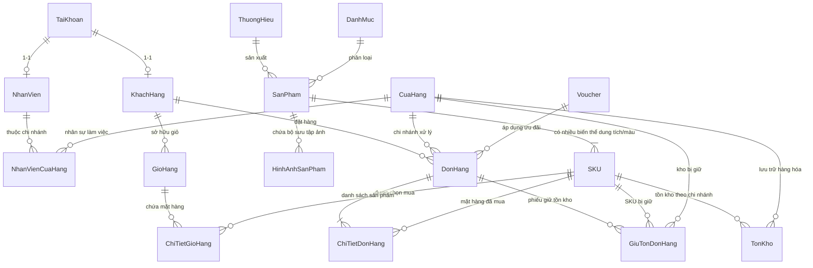

# BẢN ĐỒ TỔNG QUAN DỰ ÁN LUNEA (01_Project_Map.md)
## Nền Tảng Thương Mại Điện Tử & Quản Lý Chuỗi Cửa Hàng Mỹ Phẩm

> **Mục đích tài liệu:** Cung cấp bức tranh toàn cảnh về kiến trúc, công nghệ, cấu trúc thư mục, cơ sở dữ liệu và vị trí các file mã nguồn trọng yếu. Dùng làm tài liệu tra cứu nhanh trong 2 ngày ôn tập vấn đáp tốt nghiệp/bảo vệ đồ án môn học.

---

## 1. TỔNG QUAN DỰ ÁN (ELEVATOR SUMMARY)

1. **LUNEA** là hệ thống thương mại điện tử chuyên ngành mỹ phẩm hoạt động theo **mô hình chuỗi cửa hàng vật lý (Showroom Chain Management)**.
2. Hệ thống giải quyết bài toán cốt lõi: **Quản lý danh mục sản phẩm và chính sách giá/khuyến mãi tập trung**, nhưng **theo dõi tồn kho, phân bổ nhân viên và xử lý đơn hàng theo từng chi nhánh độc lập**.
3. Khách hàng trực tuyến có thể tìm kiếm, lọc sản phẩm theo **loại da/nhu cầu điều trị**, kiểm tra **số lượng tồn kho khả dụng tại từng showroom gần nhất** trước khi quyết định mua.
4. Khi đặt hàng online, hệ thống tự động điều phối đơn hàng về chi nhánh cùng tỉnh/thành phố có đủ tồn kho, thực hiện cơ chế **giữ tồn kho (Stock Reservation)** để tránh bán vượt tồn (overselling).
5. Nhân sự tại các chi nhánh được phân quyền theo mô hình **StoreScope (Phân quyền theo phạm vi chi nhánh)**: nhân viên showroom nào chỉ được nhìn thấy và thao tác trên đơn hàng/kho của showroom đó, chống rò rỉ dữ liệu chéo.
6. Hệ thống được xây dựng trên nền tảng **Java 21**, **Spring Boot 4.1.1** (Spring Framework 6+), tích hợp cơ chế bảo mật kép **Stateless JWT Cookie (HttpOnly/SameSite/Secure)** và hỗ trợ song song hai hệ quản trị CSDL công nghiệp: **PostgreSQL 16** (cho Cloud Render/Docker) và **Microsoft SQL Server** (cho môi trường Local).
7. Đã hoàn thiện **163/163 bài kiểm thử tự động (Unit & Integration Tests)** chạy trên H2 Database bộ nhớ đạt tỷ lệ thành công 100%.

---

## 2. BẢNG KIỂM KÊ CÔNG NGHỆ VÀ TRẠNG THÁI XÁC MINH

| Nội dung | Công nghệ / Thư viện thực tế trong code | Trạng thái xác minh | Bằng chứng mã nguồn / Cấu hình |
|---|---|:---:|---|
| **Ngôn ngữ nền tảng** | **Java 21** (LTS) | Đã xác minh | `pom.xml` (`<java.version>21</java.version>`), build compiler plugin |
| **Framework Web** | **Spring Boot 4.1.1** (Spring MVC + REST) | Đã xác minh | `pom.xml` (`spring-boot-starter-web`) |
| **Giao diện & View** | **Thymeleaf + Bootstrap 5 + Vanilla CSS/JS** | Đã xác minh | `src/main/resources/templates/`, `src/main/resources/static/` |
| **Bảo mật (Security)** | **Spring Security 6+ & OAuth2 Resource Server** | Đã xác minh | `SecurityConfig.java`, `CookieBearerTokenResolver.java` |
| **Cơ chế xác thực** | **Stateless JWT** lưu trong **Cookie `LUNEA_AT`** (HttpOnly) | Đã xác minh | `AuthCookieFactory.java`, `JwtService.java`, `JwtAuthConverter.java` |
| **Phân quyền chi nhánh** | **StoreScope Component** (Lọc Store ID động) | Đã xác minh | `StoreScope.java`, `AdminOrderRestController.java` |
| **ORM / Data Access** | **Spring Data JPA + Hibernate ORM** | Đã xác minh | `pom.xml` (`spring-boot-starter-data-jpa`), các repository |
| **Cơ sở dữ liệu chính** | **PostgreSQL 16** (Cloud) & **MS SQL Server** (Local) | Đã xác minh | `application.properties`, thư mục `database/` (01-06 SQL scripts) |
| **Database kiểm thử** | **H2 Database Engine** (In-Memory) | Đã xác minh | `src/test/resources/application.properties`, 163 tests pass |
| **Ánh xạ Object (DTO)**| **MapStruct 1.6.3** kết hợp **Lombok 1.18.48** | Đã xác minh | `pom.xml`, các mapper trong package `com.thinh.cosmetic.mapper` |
| **Lưu trữ hình ảnh** | **Cloudinary CDN (cloudinary-http5 2.0.0)** | Đã xác minh | `CloudinaryConfig.java`, `CloudinaryService.java` |
| **Dịch vụ gửi Mail OTP**| **Brevo REST API (HTTPS)** + Spring Mail SMTP Fallback | Đã xác minh | `EmailServiceImpl.java`, `application.properties` |
| **Kiểm thử tự động** | **JUnit 5 + Mockito + Spring Boot Starter Test** | Đã xác minh | `src/test/java/`, **163/163 Tests PASS** |
| **Triển khai Cloud** | **Docker Multi-Stage Build** trên **Render PaaS** | Đã xác minh | `Dockerfile`, `HUONG_DAN_CAI_DAT_VA_SU_DUNG.md` |

---

## 3. SƠ ĐỒ KIẾN TRÚC HỆ THỐNG VÀ LUỒNG XỬ LÝ (SYSTEM ARCHITECTURE)

Dự án áp dụng mô hình **Layered Architecture (Kiến trúc phân tầng)** kết hợp **Dual Presentation (Mô hình giao diện kép: Server-Side Rendering với Thymeleaf cho trải nghiệm SEO/Storefront và REST API JSON cho các tác vụ bất đồng bộ AJAX/Admin)**.

```mermaid
flowchart TB
    subgraph ClientLayer ["1. CLIENT TIER (Trình duyệt)"]
        BrowserStorefront["Storefront (Khách hàng)<br/>HTML5 / Thymeleaf / JavaScript fetch API"]
        BrowserAdmin["Admin Portal (Ban quản trị & Showroom)<br/>Bootstrap / Dynamic Modals / AJAX"]
    end

    subgraph SecurityTier ["2. SECURITY & AUTH FILTER TIER"]
        XRequestedWithFilter["XRequestedWithFilter<br/>(Nhận diện AJAX Request)"]
        CookieResolver["CookieBearerTokenResolver<br/>(Trích xuất JWT từ Cookie 'LUNEA_AT' hoặc Header)"]
        JwtFilter["BearerTokenAuthenticationFilter & NimbusJwtDecoder<br/>(Giải mã & Xác thực chữ ký HS256)"]
        JwtAuthConverter["JwtAuthConverter<br/>(Map Claim thành Authorities: ROLE_... & Permissions)"]
    end

    subgraph ControllerTier ["3. CONTROLLER / PRESENTATION TIER"]
        PageControllers["MVC Page Controllers<br/>(HomeController, ProductPageController,<br/>CartPageController, CheckoutPageController, AdminPageController)"]
        RestControllers["REST API Controllers<br/>(AuthRestController, ProductRestController,<br/>OrderRestController, AdminOrderRestController, InventoryRestController)"]
    end

    subgraph ServiceTier ["4. SERVICE / BUSINESS LOGIC TIER"]
        StoreScope["StoreScope Component<br/>(Kiểm soát phạm vi chi nhánh)"]
        OrderService["OrderServiceImpl<br/>(Đặt hàng, phân bổ kho, giữ tồn, chuyển trạng thái)"]
        ProductService["ProductServiceImpl<br/>(Tìm kiếm chuẩn hóa tiếng Việt, lọc đa tiêu chí)"]
        InventoryService["InventoryServiceImpl<br/>(Kiểm kê, điều chỉnh tồn thực tế)"]
        VoucherService["VoucherServiceImpl<br/>(Định giá chiết khấu, hạn mức, đếm số lượt)"]
        OtpService["OtpServiceImpl<br/>(Bảo mật OTP, chống brute-force, gửi mail Brevo)"]
    end

    subgraph PersistenceTier ["5. DATA ACCESS / REPOSITORY TIER"]
        SpringDataJPA["Spring Data JPA Repositories<br/>(OrderRepository, InventoryRepository,<br/>ProductRepository, AccountRepository...)"]
        Hibernate["Hibernate 6 ORM<br/>(Entity Lifecycle, First-Level Cache, Dialect Mapping)"]
    end

    subgraph DatabaseTier ["6. DATABASE TIER"]
        SQLServer["Microsoft SQL Server (Môi trường phát triển Local)"]
        Postgres["PostgreSQL 16 (Render Cloud Production)"]
        H2["H2 In-Memory (Bộ kiểm thử tự động 163 Tests)"]
    end

    ClientLayer --> SecurityTier
    SecurityTier --> ControllerTier
    ControllerTier --> ServiceTier
    ServiceTier --> PersistenceTier
    PersistenceTier --> DatabaseTier
```



### Trách nhiệm chi tiết của từng tầng:
1. **Security Tier:** Chặn bắt mọi request trước khi vào controller. Giải mã cookie `LUNEA_AT`, nạp đối tượng `AuthPrincipal` vào `SecurityContextHolder`. Không sử dụng HTTP Session của Tomcat (`SessionCreationPolicy.STATELESS`), giúp tiết kiệm RAM máy chủ và loại bỏ rủi ro CSRF truyền thống.
2. **Controller Tier:** Tiếp nhận request, phân tách giữa Render HTML trang web (`@Controller`) và xử lý dữ liệu trả JSON (`@RestController`). Chịu trách nhiệm validate DTO (`@Valid`).
3. **Service Tier:** Chứa 100% logic nghiệp vụ cốt lõi. Quản lý ranh giới giao dịch `@Transactional`. Sử dụng `StoreScope` để chặn nhân viên chi nhánh truy cập tài nguyên ngoài phạm vi showroom được phân công.
4. **Repository Tier:** Giao tiếp với database thông qua các interface kế thừa `JpaRepository`. Sử dụng JPQL tối ưu, Batch Fetching để triệt tiêu lỗi N+1 Query.
5. **Database Tier:** Lưu trữ dữ liệu quan hệ với các ràng buộc toàn vẹn khóa ngoại, Unique, và Index tăng tốc tra cứu.

---

## 4. BẢN ĐỒ CẤU TRÚC THƯ MỤC SOURCE CODE (`src/main/java`)

```
com.thinh.cosmetic
│
├── CosmeticStoreChainManagementApplication.java  <-- [MAIN ENTRY] Khởi chạy Spring Boot & @EnableAsync
│
├── config/                                       <-- Cấu hình hệ thống & Beans
│   ├── AppProperties.java                        <-- Đọc cấu hình từ application.properties (JWT, Mail)
│   ├── CloudinaryConfig.java                     <-- Khởi tạo Cloudinary Singleton Bean
│   ├── DataSeeder.java                           <-- Tự động nạp dữ liệu mẫu ban đầu (240 SP, 3 Store, 5 Acc)
│   └── SecurityConfig.java                       <-- Cấu hình Spring Security 6, FilterChain, Stateless JWT
│
├── domain/                                       <-- Mô hình dữ liệu Domain
│   ├── dto/
│   │   ├── request/                              <-- Payload nhận từ Client (Validate bằng Jakarta Constraints)
│   │   │   ├── account/ (LoginRequest, RegisterRequest, SendOtpRequest, ResetPasswordRequest)
│   │   │   ├── catalog/ (ProductRequest, ProductSkuRequest, BrandRequest, CategoryRequest)
│   │   │   ├── inventory/ (InventoryAdjustmentRequest, StockTransferRequest)
│   │   │   └── order/ (OrderRequest, UpdateOrderStatusRequest, VoucherRequest)
│   │   └── response/                             <-- DTO trả về cho Client (Đóng gói thông tin an toàn)
│   │       ├── account/ (AuthResponse, CustomerResponse, EmployeeResponse, SendOtpResponse)
│   │       ├── catalog/ (ProductResponse, ProductSkuResponse, CategoryResponse, BrandResponse)
│   │       ├── order/ (OrderResponse, OrderItemResponse, OrderPreviewResponse)
│   │       └── ErrorResponse.java                <-- Chuẩn hóa phản hồi lỗi (Timestamp, Code, FieldErrors)
│   ├── entity/                                   <-- JPA Entities (Ánh xạ 1:1 sang bảng CSDL)
│   │   ├── account/ (AccountEntity, CustomerEntity, EmployeeEntity, RoleEntity, PermissionEntity, ...)
│   │   ├── catalog/ (ProductEntity, ProductSkuEntity, BrandEntity, CategoryEntity, ProductImageEntity, ...)
│   │   ├── inventory/ (StoreEntity, InventoryEntity, InventoryAdjustmentEntity, StockTransferEntity, ...)
│   │   ├── sales/ (OrderEntity, OrderItemEntity, OrderReservationEntity, CartEntity, CartItemEntity, VoucherEntity)
│   │   ├── returns/ (ReturnRequestEntity, ReturnItemEntity)
│   │   └── review/ (ReviewEntity)
│   └── enums/                                    <-- Các kiểu liệt kê nghiệp vụ
│       ├── OrderStatus.java                      <-- State machine: PENDING, CONFIRMED, PREPARING, SHIPPING...
│       ├── ReservationStatus.java                <-- Trạng thái giữ hàng: HELD, COMMITTED, RELEASED
│       ├── ActiveStatus.java                     <-- ACTIVE, INACTIVE
│       ├── PaymentMethod.java                    <-- COD, BANKING, VNPAY
│       └── DiscountType.java                     <-- PERCENTAGE, FIXED_AMOUNT, FREE_SHIPPING
│
├── repository/                                   <-- Tầng truy cập dữ liệu (Spring Data JPA)
│   ├── account/ (AccountRepository, CustomerRepository, EmployeeStoreRepository...)
│   ├── cart/ (CartRepository, CartItemRepository)
│   ├── catalog/ (ProductRepository, ProductSkuRepository, BrandRepository, CategoryRepository...)
│   ├── order/ (OrderRepository, OrderItemRepository, OrderReservationRepository, VoucherRepository)
│   ├── store/ (StoreRepository, InventoryRepository)
│   ├── returns/ (ReturnRequestRepository, ReturnItemRepository)
│   └── review/ (ReviewRepository)
│
├── service/                                      <-- Tầng nghiệp vụ (Interfaces & Implementations)
│   ├── account/ (AccountService, CustomerService, EmployeeService, OtpService)
│   ├── cart/ (CartService, WishListService)
│   ├── catalog/ (ProductService, BrandService, CategoryService)
│   ├── notification/ (EmailService - Brevo API & SMTP Fallback)
│   ├── order/ (OrderService, VoucherService)
│   ├── returns/ (ReturnService)
│   ├── review/ (ReviewService)
│   ├── storage/ (CloudinaryService)
│   └── store/ (InventoryService, StoreService, StockTransferService)
│
├── controller/                                   <-- Tầng hiển thị View MVC (Thymeleaf Pages)
│   ├── HomeController.java                       <-- Trang chủ `/`, `/home`
│   ├── ProductPageController.java                <-- Trang danh sách sản phẩm `/products` & chi tiết `/products/{id}`
│   ├── CartPageController.java                   <-- Trang giỏ hàng `/cart`
│   ├── CheckoutPageController.java               <-- Trang thanh toán `/checkout`, kết quả `/order-success`
│   ├── AccountPageController.java                <-- Hồ sơ cá nhân `/account`, đơn hàng `/account/orders`
│   ├── AuthPageController.java                   <-- Trang đăng nhập `/login`, đăng ký `/register`, `/reset-password`
│   ├── AdminPageController.java                  <-- Cổng quản trị `/admin/**` (Dashboard, Orders, Inventory...)
│   └── CustomErrorController.java                <-- Xử lý trang lỗi thân thiện `/error` (403, 404, 500)
│
├── rest/                                         <-- Tầng API Endpoint JSON (AJAX & Mobile Client)
│   ├── account/ (AuthRestController, CustomerRestController, EmployeeRestController, RoleRestController)
│   ├── cart/ (CartRestController, WishListRestController)
│   ├── catalog/ (ProductRestController, BrandRestController, CategoryRestController, UploadRestController)
│   ├── order/ (OrderRestController, AdminOrderRestController, VoucherRestController)
│   ├── returns/ (ReturnRestController)
│   ├── review/ (ReviewRestController)
│   └── store/ (InventoryRestController, StoreRestController, StockTransferRestController)
│
├── security/                                     <-- Thành phần bảo vệ & phân quyền
│   ├── AppUserDetails.java                       <-- Triển khai Spring Security UserDetails
│   ├── AppUserDetailsService.java               <-- Nạp Account từ CSDL, ánh xạ Roles & Permissions
│   ├── AuthCookieFactory.java                    <-- Tạo & Xóa Cookie HttpOnly `LUNEA_AT` an toàn
│   ├── AuthPrincipal.java                        <-- Đối tượng Principal tùy biến mang ID, Roles, StoreId
│   ├── CookieBearerTokenResolver.java            <-- Trích xuất Bearer Token từ Cookie hoặc Authorization Header
│   ├── JsonAuthEntryPoint.java                   <-- Trả mã 401 Unauthorized dạng JSON chuẩn
│   ├── JsonAccessDeniedHandler.java              <-- Trả mã 403 Forbidden dạng JSON chuẩn
│   ├── JwtAuthConverter.java                     <-- Chuyển đổi JWT Claims thành GrantedAuthority
│   ├── JwtService.java                           <-- Ký và sinh chuỗi JWT HMAC-SHA256
│   ├── StoreScope.java                           <-- Lõi cô lập dữ liệu theo Showroom cho Nhân sự
│   └── XRequestedWithFilter.java                 <-- Bộ lọc nhận diện request đến từ AJAX/fetch
│
├── exception/                                    <-- Xử lý lỗi toàn cục
│   ├── BusinessException.java                    <-- RuntimeException mang ErrorCode định danh
│   ├── ErrorCode.java                            <-- Enum mã lỗi nghiệp vụ & HTTP Status tương ứng
│   └── GlobalExceptionHandler.java               <-- @RestControllerAdvice bắt và đóng gói JSON lỗi
│
└── mapper/                                       <-- Tự động chuyển đổi Entity <-> DTO (MapStruct)
    ├── account/ (AccountMapper, CustomerMapper, EmployeeMapper)
    ├── catalog/ (ProductMapper, ProductSkuMapper, BrandMapper, CategoryMapper)
    ├── purchase/ (SupplierMapper, PurchaseOrderMapper)
    └── store/ (StoreMapper, InventoryMapper)
```

---

## 5. THIẾT KẾ CƠ SỞ DỮ LIỆU & QUAN HỆ CỐT LÕI (DATABASE SCHEMA)

Cơ sở dữ liệu của LUNEA gồm **40 bảng quan hệ**, phản ánh đầy đủ mô hình chuỗi cửa hàng mỹ phẩm. Dưới đây là các cụm bảng cốt lõi nhất cần nắm vững:



### Các bảng dữ liệu trọng yếu và ý nghĩa nghiệp vụ:
1. **`TaiKhoan` (Account):** Chứa thông tin đăng nhập tập trung (`username`, `email`, `phone`, `password_hash`, `status`). Dùng chung cho cả Khách hàng và Nhân viên.
2. **`NhanVienCuaHang` (EmployeeStore):** Bảng liên kết Many-to-Many giữa `NhanVien` và `CuaHang`, có cờ `is_primary`. Đây là mấu chốt để `StoreScope` xác định nhân viên được phép xem đơn hàng/kho của chi nhánh nào.
3. **`SanPham` (Product) & `SKU` (ProductSku):**
   - `SanPham`: Lưu thông tin chung (tên, thương hiệu, danh mục, mô tả, thành phần, cách dùng).
   - `SKU`: Lưu thông tin biến thể cụ thể (dung tích 30ml/50ml/100ml, mã vạch `barcode`, giá niêm yết `original_price`, giá bán `price`).
4. **`TonKho` (Inventory):**
   - Khóa duy nhất: cặp `(cua_hang_id, sku_id)` (`UNIQUE CONSTRAINT`).
   - Cột quan trọng: `actual_stock` (tồn kho vật lý thực tế trong showroom) và `held_quantity` (số lượng đang tạm giữ cho các đơn hàng chưa giao).
   - **Công thức bất biến:** $\text{Tồn khả dụng (Available Stock)} = \text{actual\_stock} - \text{held\_quantity}$.
5. **`GiuTonDonHang` (OrderReservation):** Ghi nhận chi tiết từng đơn hàng đang giữ bao nhiêu lượng của SKU nào tại chi nhánh nào (`status`: `HELD`, `COMMITTED`, `RELEASED`).
6. **`DonHang` (Order) & `ChiTietDonHang` (OrderItem):**
   - `ChiTietDonHang` lưu **Snapshot giá và tên** (`snapshot_product_name`, `snapshot_variant_name`, `snapshot_price`) tại thời điểm bấm đặt hàng. Sau này nếu giá sản phẩm tăng/giảm thì đơn hàng trong quá khứ không bao giờ bị sai lệch doanh thu.

---

## 6. DANH SÁCH CÁC FILE QUAN TRỌNG NHẤT CẦN ÔN TRONG 2 NGÀY

Khi giảng viên yêu cầu mở mã nguồn để giải thích, hãy mở chính xác các file sau:

| STT | Đường dẫn file tương đối | Vai trò trong dự án | Lý do bắt buộc phải học |
|:---:|---|---|---|
| **1** | [`service/order/impl/OrderServiceImpl.java`](file:///c:/Users/Dev/OneDrive/Desktop/lunea/CNPM/src/main/java/com/thinh/cosmetic/service/order/impl/OrderServiceImpl.java) | Trái tim xử lý đơn hàng & tồn kho | Chứa toàn bộ luồng: đặt hàng, tính voucher, thuật toán tự chọn chi nhánh gần nhất có đủ hàng, giữ tồn, và giải quyết triệt để N+1 Query. |
| **2** | [`config/SecurityConfig.java`](file:///c:/Users/Dev/OneDrive/Desktop/lunea/CNPM/src/main/java/com/thinh/cosmetic/config/SecurityConfig.java) | Cấu hình bảo mật toàn hệ thống | Chứng minh kiến trúc Stateless JWT, HttpOnly Cookie, bảo vệ các endpoint theo Role và Permission. |
| **3** | [`security/StoreScope.java`](file:///c:/Users/Dev/OneDrive/Desktop/lunea/CNPM/src/main/java/com/thinh/cosmetic/security/StoreScope.java) | Cô lập dữ liệu chi nhánh | Giải thích cách hệ thống chặn nhân viên Hà Nội xem trộm đơn hàng của TP.HCM. Điểm nhấn kiến trúc chuỗi showroom. |
| **4** | [`security/CookieBearerTokenResolver.java`](file:///c:/Users/Dev/OneDrive/Desktop/lunea/CNPM/src/main/java/com/thinh/cosmetic/security/CookieBearerTokenResolver.java) | Bộ trích xuất Token thông minh | Cầu nối xác thực giữa giao diện web Thymeleaf (dùng Cookie) và các công cụ gọi API như Postman/Mobile App (dùng Header). |
| **5** | [`service/catalog/impl/ProductServiceImpl.java`](file:///c:/Users/Dev/OneDrive/Desktop/lunea/CNPM/src/main/java/com/thinh/cosmetic/service/catalog/impl/ProductServiceImpl.java) | Tìm kiếm & Bộ lọc mỹ phẩm | Chứa thuật toán chuẩn hóa tiếng Việt loại bỏ dấu (`stripAccents`), lọc theo loại da và nhu cầu. |
| **6** | [`service/account/impl/OtpServiceImpl.java`](file:///c:/Users/Dev/OneDrive/Desktop/lunea/CNPM/src/main/java/com/thinh/cosmetic/service/account/impl/OtpServiceImpl.java) | Cơ chế bảo mật tài khoản qua OTP | Minh chứng cho kỹ thuật bảo mật: dùng `SecureRandom`, chống gửi dồn (cooldown 30s), giới hạn 5 lần nhập sai, gửi email Brevo thật. |
| **7** | [`service/order/impl/VoucherServiceImpl.java`](file:///c:/Users/Dev/OneDrive/Desktop/lunea/CNPM/src/main/java/com/thinh/cosmetic/service/order/impl/VoucherServiceImpl.java) | Động cơ tính khuyến mãi | Logic kiểm tra điều kiện voucher (đơn tối thiểu, hạn mức giảm tối đa, kiểm tra số lượt dùng). |
| **8** | [`exception/GlobalExceptionHandler.java`](file:///c:/Users/Dev/OneDrive/Desktop/lunea/CNPM/src/main/java/com/thinh/cosmetic/exception/GlobalExceptionHandler.java) | Xử lý ngoại lệ tập trung | Đóng gói thông báo lỗi chuẩn RFC-7807 trả về cho Client, bắt lỗi validate payload `@Valid`. |
| **9** | [`domain/enums/OrderStatus.java`](file:///c:/Users/Dev/OneDrive/Desktop/lunea/CNPM/src/main/java/com/thinh/cosmetic/domain/enums/OrderStatus.java) | Máy trạng thái vòng đời đơn hàng | Phương thức `canTransitionTo()` định nghĩa chính xác các bước chuyển trạng thái hợp lệ. |
| **10** | [`config/DataSeeder.java`](file:///c:/Users/Dev/OneDrive/Desktop/lunea/CNPM/src/main/java/com/thinh/cosmetic/config/DataSeeder.java) | Tự động khởi tạo dữ liệu | Chứng minh ứng dụng tự nạp sẵn 240 sản phẩm, 3 chi nhánh, 5 tài khoản demo khi khởi chạy lần đầu. |

---

## 7. MA TRẬN PHÂN LOẠI NỘI DUNG ƯU TIÊN ÔN TẬP TRONG 2 NGÀY

```
+-----------------------------------------------------------------------------------+
| MỨC ĐỘ 1: BẮT BUỘC PHẢI THUỘC VÀ GIẢI THÍCH ĐƯỢC (90% KHẢ NĂNG BỊ HỎI)            |
+-----------------------------------------------------------------------------------+
| 1. Luồng Đặt hàng -> Chọn Chi nhánh -> Giữ Tồn kho -> Huỷ Đơn / Giao Hàng.         |
| 2. Cơ chế Xác thực JWT lưu trong HttpOnly Cookie 'LUNEA_AT'.                      |
| 3. Kiến trúc phân quyền chi nhánh StoreScope (Tại sao nhân viên không thấy đơn khác)|
| 4. Khái niệm và công thức tính Tồn khả dụng (Actual Stock vs Held Quantity).      |
| 5. Giải thích vì sao cần Snapshot giá trong ChiTietDonHang.                       |
+-----------------------------------------------------------------------------------+
                                         │
                                         ▼
+-----------------------------------------------------------------------------------+
| MỨC ĐỘ 2: NÊN BIẾT ĐỂ LẤY ĐIỂM GIỎI (8.5 - 10.0)                                  |
+-----------------------------------------------------------------------------------+
| 1. Cách giải quyết vấn đề N+1 Query trong OrderServiceImpl bằng Batch Eager Fetch.|
| 2. Kỹ thuật sắp xếp SKU ID trước khi duyệt giỏ hàng để chống Deadlock CSDL.       |
| 3. Cơ chế OTP an toàn: SecureRandom, Cooldown 30s, chống Brute-force 5 lần.       |
| 4. Thuật toán lọc tiếng Việt không dấu (Normalizer NFD) trong ProductServiceImpl. |
| 5. Cấu hình tối ưu bộ nhớ JVM trên Render Docker (Xmx350m, SerialGC).             |
+-----------------------------------------------------------------------------------+
                                         │
                                         ▼
+-----------------------------------------------------------------------------------+
| MỨC ĐỘ 3: CÓ THỂ ĐỌC LƯỚT NẾU THIẾU THỜI GIAN                                     |
+-----------------------------------------------------------------------------------+
| 1. Cấu hình chi tiết kết nối Cloudinary CDN.                                      |
| 2. Logic kiểm duyệt đánh giá và trả lời review.                                   |
| 3. Bảng Wishlist và BeautyProfile (Hồ sơ da).                                     |
+-----------------------------------------------------------------------------------+
```
