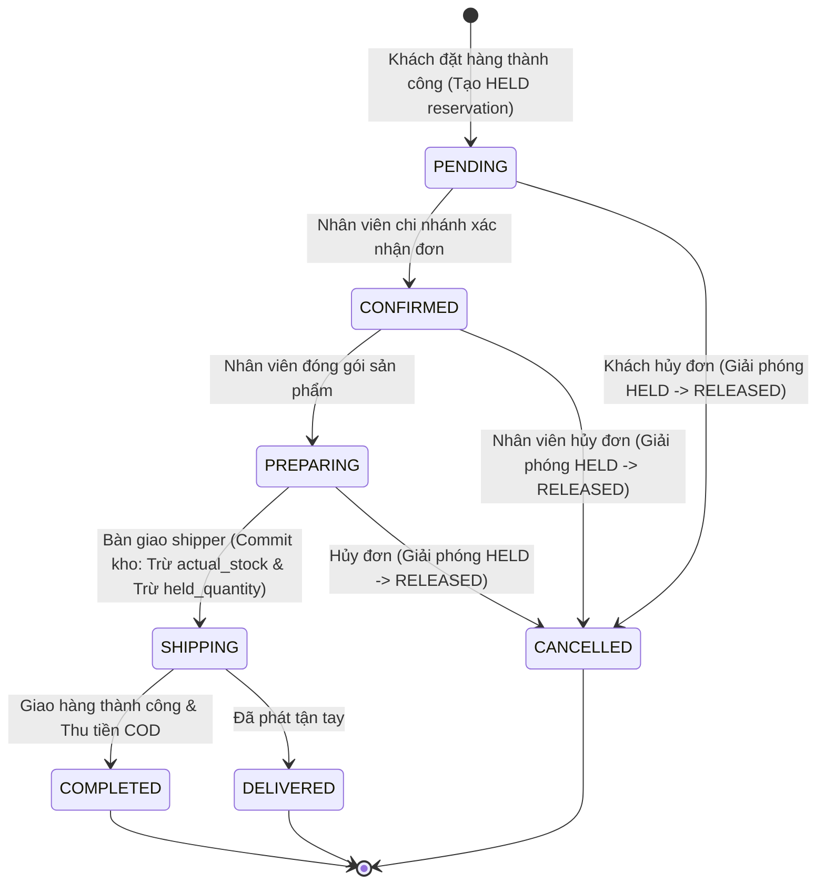

# HƯỚNG DẪN ĐỌC CODE & THEO DÕI LUỒNG NGHIỆP VỤ (02_Code_Walkthrough.md)
## Phân Tích Chi Tiết 7 Luồng Trọng Yếu & Các Đoạn Mã Cốt Lõi Dự Án LUNEA

> **Dành cho sinh viên:** Giảng viên bảo vệ đồ án thường yêu cầu: *"Em hãy chỉ ra trong code, khi người dùng bấm nút này thì request đi qua những file nào, logic nằm ở đâu và database thay đổi ra sao?"*. Tài liệu này cung cấp lời giải thích chính xác theo từng dòng mã thực tế trong dự án.

---

## MỤC LỤC 7 LUỒNG NGHIỆP VỤ TRỌNG YẾU

1. [Luồng 1: Đăng nhập & Cơ chế Xác thực JWT qua HttpOnly Cookie](#luồng-1-đăng-nhập--cơ-chế-xác-thực-jwt-qua-httponly-cookie)
2. [Luồng 2: Phân quyền Chi nhánh Cô lập (StoreScope Security)](#luồng-2-phân-quyền-chi-nhánh-cô-lập-storescope-security)
3. [Luồng 3: Đặt hàng Online, Tự chọn Chi nhánh & Giữ Tồn kho (Stock Hold)](#luồng-3-đặt-hàng-online-tự-chọn-chi-nhánh--giữ-tồn-kho-stock-hold)
4. [Luồng 4: Vòng đời Đơn hàng, Trừ Kho Thực tế & Hoàn Tồn khi Hủy](#luồng-4-vòng-đời-đơn-hàng-trừ-kho-thực-tế--hoàn-tồn-khi-hủy)
5. [Luồng 5: Động cơ Định giá & Tính toán Voucher Khuyến mãi](#luồng-5-động-cơ-định-giá--tính-toán-voucher-khuyến-mãi)
6. [Luồng 6: Tìm kiếm Sản phẩm Đa tiêu chí & Chuẩn hóa Tiếng Việt (Accent Normalization)](#luồng-6-tìm-kiếm-sản-phẩm-đa-tiêu-chí--chuẩn-hóa-tiếng-việt-accent-normalization)
7. [Luồng 7: Khôi phục Mật khẩu an toàn qua OTP & Brevo Email Service](#luồng-7-khôi-phục-mật-khẩu-an-toàn-qua-otp--brevo-email-service)

---

## LUỒNG 1: ĐĂNG NHẬP & CƠ CHẾ XÁC THỰC JWT QUA HTTPONLY COOKIE

### 1. Trình tự luồng thực tế (Call Flow)
1. **Người dùng thao tác:** Mở trang `/login`, nhập username/email (`admin` hoặc `khach01`) và mật khẩu `123456`, bấm nút **"Đăng nhập"**.
2. **Frontend gửi:** Script Javascript trên trang `login.html` gửi một HTTP POST request bất đồng bộ:
   `POST /api/auth/login` kèm payload JSON `{"usernameOrEmail":"admin", "password":"123456"}`.
3. **Controller tiếp nhận:** [`rest/account/AuthRestController.java`](file:///c:/Users/Dev/OneDrive/Desktop/lunea/CNPM/src/main/java/com/thinh/cosmetic/rest/account/AuthRestController.java) tiếp nhận tại method `login(@Valid @RequestBody LoginRequest request)`.
4. **Xác thực danh tính:** Gọi `authenticationManager.authenticate(...)`.
   - Spring Security kích hoạt [`security/AppUserDetailsService.java`](file:///c:/Users/Dev/OneDrive/Desktop/lunea/CNPM/src/main/java/com/thinh/cosmetic/security/AppUserDetailsService.java).
   - Truy vấn database tìm tài khoản: `accountRepository.findByUsernameOrEmail(...)`.
   - Dùng `BCryptPasswordEncoder` để so khớp chuỗi băm mật khẩu.
   - Nạp các quyền hạn (`ROLE_ADMIN`, `ROLE_CUSTOMER`, hoặc các permissions như `ORDER_PROCESS`, `INVENTORY_VIEW`).
5. **Sinh Token & Thiết lập Cookie:**
   - [`security/JwtService.java`](file:///c:/Users/Dev/OneDrive/Desktop/lunea/CNPM/src/main/java/com/thinh/cosmetic/security/JwtService.java) tạo chuỗi JWT chứa: Subject (ID tài khoản), Claims (roles, employeeId, customerId), thời hạn sống (TTL = 7200 giây / 2 giờ).
   - [`security/AuthCookieFactory.java`](file:///c:/Users/Dev/OneDrive/Desktop/lunea/CNPM/src/main/java/com/thinh/cosmetic/security/AuthCookieFactory.java) bọc chuỗi JWT vào Cookie `LUNEA_AT` với các cờ bảo mật:
     * `httpOnly = true`: Chặn mã độc JavaScript (XSS) đọc cắp token.
     * `sameSite = "Lax"`: Ngăn chặn tấn công CSRF khi điều hướng chéo domain.
     * `path = "/"`: Có hiệu lực trên toàn bộ website.
6. **Response trả về:** HTTP Header `Set-Cookie: LUNEA_AT=eyJhbGciOi...` và Body chứa thông tin cơ bản của User. Trình duyệt tự lưu Cookie này và gửi kèm trong **mọi request tiếp theo**.
7. **Cơ chế xác thực các request sau:**
   - [`security/CookieBearerTokenResolver.java`](file:///c:/Users/Dev/OneDrive/Desktop/lunea/CNPM/src/main/java/com/thinh/cosmetic/security/CookieBearerTokenResolver.java) can thiệp vào bộ lọc `BearerTokenAuthenticationFilter`: Ưu tiên đọc header `Authorization: Bearer <token>`, nếu không có sẽ tự động trích xuất token từ Cookie `LUNEA_AT`.
   - [`security/JwtAuthConverter.java`](file:///c:/Users/Dev/OneDrive/Desktop/lunea/CNPM/src/main/java/com/thinh/cosmetic/security/JwtAuthConverter.java) đọc Claims và nạp đối tượng `AuthPrincipal` vào `SecurityContextHolder`.

---

## LUỒNG 2: PHÂN QUYỀN CHI NHÁNH CÔ LẬP (STORESCOPE SECURITY)

### 1. Vấn đề nghiệp vụ
Trong mô hình chuỗi cửa hàng, nhân viên chi nhánh Hồ Chí Minh không được xem doanh thu, đơn hàng hay can thiệp vào kho của chi nhánh Hà Nội. Nếu chỉ dùng `@PreAuthorize("hasRole('EMPLOYEE')")`, mọi nhân viên sẽ thấy chung toàn bộ dữ liệu của nhau.

### 2. Trình tự luồng thực tế (Call Flow)
1. **Nhân viên thao tác:** Nhân viên `order_hn` (Hà Nội) đăng nhập và truy cập trang Quản lý đơn hàng `/admin/orders`.
2. **Controller tiếp nhận:** [`rest/order/AdminOrderRestController.java`](file:///c:/Users/Dev/OneDrive/Desktop/lunea/CNPM/src/main/java/com/thinh/cosmetic/rest/order/AdminOrderRestController.java) nhận request `GET /api/admin/orders`.
3. **Thẩm định quyền & Lấy phạm vi:**
   - Controller lấy thông tin người dùng hiện tại thông qua annotation `@AuthenticationPrincipal AuthPrincipal principal`.
   - Chuyển `principal` vào service: `orderService.getOrders(principal, storeId)`.
4. **Phân giải chi nhánh qua StoreScope:**
   - [`security/StoreScope.java`](file:///c:/Users/Dev/OneDrive/Desktop/lunea/CNPM/src/main/java/com/thinh/cosmetic/security/StoreScope.java) thực thi hàm `getAccessibleStoreIds(principal)`:
     ```java
     boolean hasAllStores = principal.getAuthorities().stream()
         .map(GrantedAuthority::getAuthority)
         .anyMatch(a -> "ALL_STORES".equals(a) || "ROLE_ADMIN".equals(a) || "ADMIN".equals(a));

     if (hasAllStores) {
         return null; // Null mang ý nghĩa: Được xem toàn chuỗi (Admin)
     }

     List<EmployeeStoreEntity> employeeStores = employeeStoreRepository.findByEmployeeId(principal.getEmployeeId());
     return employeeStores.stream()
         .map(es -> es.getStore().getId())
         .toList();
     ```
5. **Truy vấn CSDL có lọc:**
   - Nếu `accessibleIds == null` (Admin): Thực hiện `orderRepository.findAllByOrderByCreatedAtDesc()`.
   - Nếu `accessibleIds` là danh sách cụ thể (ví dụ `[2]` cho Hà Nội): Thực hiện:
     `orderRepository.findByAssignedStoreIdInOrderByCreatedAtDesc(accessibleIds)`.
6. **Bảo vệ chống can thiệp trực tiếp bằng ID (Tampering):**
   - Nếu nhân viên `order_hn` cố tình đoán ID và gửi request cập nhật trạng thái đơn hàng của HCM: `PUT /api/orders/1/status`.
   - Trong `OrderServiceImpl.java`:
     ```java
     if (principal != null && order.getAssignedStore() != null) {
         if (!storeScope.canAccessStore(principal, order.getAssignedStore().getId())) {
             throw new BusinessException(ErrorCode.ACCESS_DENIED,
                 "Bạn không có quyền thao tác đơn hàng của chi nhánh: " + order.getAssignedStore().getName());
         }
     }
     ```
   - Server lập tức chặn đứng và ném về mã lỗi **HTTP 403 Forbidden**.

---

## LUỒNG 3: ĐẶT HÀNG ONLINE, TỰ CHỌN CHI NHÁNH & GIỮ TỒN KHO (STOCK HOLD)

Đây là **luồng quan trọng nhất trong toàn bộ đồ án**.

### 1. Trình tự luồng thực tế (Call Flow)
1. **Người dùng thao tác:** Khách hàng mở trang `/checkout`, chọn địa chỉ nhận hàng, nhập mã voucher `LUNEA10`, chọn phương thức thanh toán COD, bấm **"Đặt hàng"**.
2. **Frontend gửi:** `POST /api/orders` kèm payload `OrderRequest`:
   - `customerAddressId`: ID địa chỉ đã lưu (hoặc địa chỉ mới).
   - `voucherCode`: `"LUNEA10"`.
   - `fulfillmentStoreId`: `null` (để hệ thống tự động chọn chi nhánh tối ưu) hoặc ID showroom khách muốn chỉ định.
   - `paymentMethod`: `"COD"`.
3. **Controller tiếp nhận:** [`rest/order/OrderRestController.java`](file:///c:/Users/Dev/OneDrive/Desktop/lunea/CNPM/src/main/java/com/thinh/cosmetic/rest/order/OrderRestController.java) nhận tại:
   `public ResponseEntity<OrderResponse> placeOrder(@AuthenticationPrincipal AuthPrincipal principal, @RequestBody OrderRequest request)`.
4. **Service xử lý:** Gọi [`OrderServiceImpl.placeOrder(customerId, request)`](file:///c:/Users/Dev/OneDrive/Desktop/lunea/CNPM/src/main/java/com/thinh/cosmetic/service/order/impl/OrderServiceImpl.java#L78-L327).
   - Kiểm tra giỏ hàng trong CSDL: `cartRepository.findByCustomerId(...)`, nếu trống ném `EMPTY_CART`.
   - Tính tổng tiền hàng sơ bộ (`subtotal`).
   - Validate voucher qua `voucherService.validateAndApply(...)`, trừ tiền giảm giá và miễn phí ship nếu đơn $\ge$ 500.000đ.
5. **Thuật toán Tự động Phân bổ Chi nhánh (Store Fulfillment Routing):**
   - Hệ thống quét danh sách các chi nhánh đang hoạt động (`ACTIVE`).
   - Kiểm tra tồn kho khả dụng $(\text{actual\_stock} - \text{held\_quantity})$ của từng sản phẩm trong giỏ tại chi nhánh.
   - Lọc ra danh sách các chi nhánh có đủ 100% các mặt hàng trong giỏ (`capableStores`).
   - Ưu tiên chọn showroom **cùng Tỉnh/Thành phố (`province`)** với địa chỉ nhận hàng của khách. Nếu không có showroom cùng tỉnh, lấy showroom có ID nhỏ nhất đủ hàng.
   - Nếu không có bất kỳ showroom nào có đủ hàng: ném lỗi `NO_STORE_CAN_FULFILL`.
6. **Kỹ thuật Chống Deadlock CSDL (Anti-Deadlock Mechanism):**
   - Trước khi cập nhật bảng tồn kho, hệ thống thực hiện sắp xếp danh sách sản phẩm theo ID tăng dần:
     ```java
     List<CartItemEntity> sortedCartItems = new ArrayList<>(cartItems);
     sortedCartItems.sort(Comparator.comparing(item -> item.getSku().getId()));
     ```
   - **Mục đích:** Nếu hai khách hàng cùng đặt 2 sản phẩm A và B cùng lúc, mọi luồng giao dịch đều khóa bản ghi theo thứ tự `A -> B`, loại bỏ hoàn toàn khả năng luồng 1 giữ A chờ B còn luồng 2 giữ B chờ A (loại bỏ Deadlock).
7. **Lưu Snapshot Đơn hàng & Giữ Tồn kho (Stock Hold):**
   - Tạo bản ghi `OrderEntity` với trạng thái `OrderStatus.PENDING`.
   - Tạo các bản ghi `OrderItemEntity` lưu **snapshot giá và tên**:
     ```java
     .snapshotProductName(sku.getProduct().getName())
     .snapshotVariantName(sku.getVariantName())
     .snapshotPrice(sku.getPrice())
     ```
   - Tăng lượng giữ tồn trong bảng `TonKho`:
     ```java
     inv.setHeldQuantity(inv.getHeldQuantity() + item.getQuantity());
     inventoryRepository.save(inv);
     ```
   - Tạo bản ghi phiếu giữ tồn `OrderReservationEntity`:
     `status = ReservationStatus.HELD`.
8. **Xóa giỏ hàng & Phản hồi:**
   - Xóa sạch các món trong giỏ hàng: `cartItemRepository.deleteByCartId(cart.getId())`.
   - Trả về `OrderResponse` cho Client chuyển hướng sang `/order-success?orderCode=LUN-XXXXXX`.

---

## LUỒNG 4: VÒNG ĐỜI ĐƠN HÀNG, TRỪ KHO THỰC TẾ & HOÀN TỒN KHI HỦY

### 1. Máy trạng thái (Finite State Machine)
Được định nghĩa tại [`domain/enums/OrderStatus.java`](file:///c:/Users/Dev/OneDrive/Desktop/lunea/CNPM/src/main/java/com/thinh/cosmetic/domain/enums/OrderStatus.java):



### 2. Trừ kho thực tế khi chuyển sang `SHIPPING`
Trong [`OrderServiceImpl.java`](file:///c:/Users/Dev/OneDrive/Desktop/lunea/CNPM/src/main/java/com/thinh/cosmetic/service/order/impl/OrderServiceImpl.java#L552-L568):
- Khi đơn hàng được bàn giao cho đơn vị vận chuyển (`status == OrderStatus.SHIPPING`):
  Hàng hóa chính thức rời khỏi kệ của showroom.
- Hệ thống gọi hàm `commitHeldInventory(orderId)`:
  1. Đổi trạng thái phiếu giữ tồn `OrderReservationEntity` từ `HELD` sang `COMMITTED`.
  2. Cập nhật bảng `TonKho`:
     * `actual_stock = actual_stock - quantity` (Trừ tồn kho vật lý).
     * `held_quantity = held_quantity - quantity` (Giải phóng số lượng giữ).
     * Tồn khả dụng giữ nguyên giá trị vì cả hai vế đều giảm tương ứng!

### 3. Cơ chế giải phóng hàng khi Khách hủy đơn (`CANCELLED`)
- Điều kiện hủy: Chỉ cho phép hủy khi đơn còn ở trạng thái `PENDING` (`cancelOrder(id, customerId)`).
- Khi trạng thái chuyển sang `CANCELLED`:
  1. Hoàn lại số lượt sử dụng voucher nếu đơn có dùng voucher: `voucherService.releaseUsage(...)`.
  2. Quét các phiếu giữ tồn `OrderReservationEntity`:
     * Đổi trạng thái từ `HELD` thành `RELEASED`.
     * Cập nhật bảng `TonKho`:
       `inv.setHeldQuantity(inv.getHeldQuantity() - hold.getQuantity())`.
  3. Lập tức, lượng tồn khả dụng $(\text{actual} - \text{held})$ của showroom tăng trở lại, các khách hàng khác trên website có thể mua món hàng này ngay lập tức!

---

## LUỒNG 5: ĐỘNG CƠ ĐỊNH GIÁ & TÍNH TOÁN VOUCHER KHUYẾN MÃI

### Trình tự xử lý tại [`service/order/impl/VoucherServiceImpl.java`](file:///c:/Users/Dev/OneDrive/Desktop/lunea/CNPM/src/main/java/com/thinh/cosmetic/service/order/impl/VoucherServiceImpl.java):

```java
// 1. Kiểm tra tính hợp lệ của mã Voucher
public VoucherEntity validateAndApply(String code, BigDecimal orderSubtotal) {
    VoucherEntity voucher = voucherRepository.findByCodeIgnoreCase(code)
        .orElseThrow(() -> new BusinessException(ErrorCode.VOUCHER_NOT_FOUND, "Mã giảm giá không tồn tại"));

    // Kiểm tra trạng thái hoạt động
    if (voucher.getStatus() != ActiveStatus.ACTIVE) {
        throw new BusinessException(ErrorCode.VOUCHER_INACTIVE, "Mã giảm giá đã tạm ngừng áp dụng");
    }
    // Kiểm tra thời hạn hiệu lực
    LocalDateTime now = LocalDateTime.now();
    if (now.isBefore(voucher.getStartDate()) || now.isAfter(voucher.getEndDate())) {
        throw new BusinessException(ErrorCode.VOUCHER_EXPIRED, "Mã giảm giá đã hết hạn hoặc chưa tới thời gian áp dụng");
    }
    // Kiểm tra số lượng lượt dùng tối đa
    if (voucher.getUsageLimit() != null && voucher.getUsedCount() >= voucher.getUsageLimit()) {
        throw new BusinessException(ErrorCode.VOUCHER_USAGE_EXCEEDED, "Mã giảm giá đã hết lượt sử dụng");
    }
    // Kiểm tra giá trị đơn hàng tối thiểu
    if (voucher.getMinOrderAmount() != null && orderSubtotal.compareTo(voucher.getMinOrderAmount()) < 0) {
        throw new BusinessException(ErrorCode.VOUCHER_MIN_ORDER_NOT_MET, 
            String.format("Đơn hàng chưa đạt giá trị tối thiểu %,d đ để sử dụng mã này", voucher.getMinOrderAmount().longValue()));
    }
    return voucher;
}
```

- **Tính toán tiền giảm giá (`calculateDiscount`):**
  - Nếu `DiscountType.PERCENTAGE` (ví dụ giảm 10%):
    `discount = subtotal * (discountValue / 100)`.
    Nếu có cài đặt `maxDiscountAmount` (ví dụ tối đa giảm 50.000đ):
    `discount = Math.min(discount, maxDiscountAmount)`.
  - Nếu `DiscountType.FIXED_AMOUNT`:
    `discount = discountValue`.
  - Nếu `DiscountType.FREE_SHIPPING`: Giảm thẳng vào `shippingFee`.

---

## LUỒNG 6: TÌM KIẾM SẢN PHẨM ĐA TIÊU CHÍ & CHUẨN HÓA TIẾNG VIỆT

Được triển khai tại [`service/catalog/impl/ProductServiceImpl.java`](file:///c:/Users/Dev/OneDrive/Desktop/lunea/CNPM/src/main/java/com/thinh/cosmetic/service/catalog/impl/ProductServiceImpl.java#L156-L230).

### 1. Xử lý tìm kiếm tiếng Việt không dấu (Accent Normalization)
Nếu khách gõ `"bí đao"`, `"bi dao"`, `"Bi Dao"` thì hệ thống đều phải trả về đúng *Serum Bí Đao Cocoon*.
Dự án giải quyết bằng kỹ thuật tách dấu Unicode Decomposition:
```java
private String stripAccents(String s) {
    if (s == null) return "";
    String n = Normalizer.normalize(s, Normalizer.Form.NFD);
    return n.replaceAll("\\p{M}", "").replace("đ", "d").replace("Đ", "d");
}
```
- `Normalizer.Form.NFD`: Tách ký tự có dấu thành ký tự gốc + ký tự dấu (ví dụ: `á` thành `a` + `'`).
- `\\p{M}`: Biểu thức chính quy (Regex) xóa bỏ toàn bộ dấu thanh/mũ.
- Thay thế chữ `đ/Đ` thành `d`.

### 2. Bộ lọc đa tiêu chí mỹ phẩm (Skin Type & Concerns)
- Lọc theo **Loại da (Skin Types):** Da dầu, Da khô, Nhạy cảm, Da hỗn hợp.
- Lọc theo **Nhu cầu (Concerns):** Trị mụn, Phục hồi da, Chống lão hóa, Sáng da.
- Lọc theo **Khoảng giá (Price Range):** Dưới 200k, 200k–500k, 500k–1 triệu, Trên 1 triệu.
- Kết hợp chuỗi lọc bằng Java Stream API:
  `all.stream().filter(matchesKeyword).filter(matchesSkinType).filter(matchesConcern).sorted(comparator).toList()`.

---

## LUỒNG 7: KHÔI PHỤC MẬT KHẨU AN TOÀN QUA OTP & BREVO EMAIL SERVICE

Được triển khai tại [`service/account/impl/OtpServiceImpl.java`](file:///c:/Users/Dev/OneDrive/Desktop/lunea/CNPM/src/main/java/com/thinh/cosmetic/service/account/impl/OtpServiceImpl.java).

### Các điểm nhấn an toàn kỹ thuật:
1. **Chống Spam / Gửi dồn OTP (Rate Limiting Cooldown 30s):**
   Kiểm tra thời điểm tạo OTP gần nhất. Nếu chưa qua 30 giây mà người dùng yêu cầu gửi lại sẽ bị chặn với mã `OTP_COOLDOWN`.
2. **Sinh mã ngẫu nhiên bảo mật cao (CSPRNG):**
   Không dùng `Math.random()`, dự án dùng `java.security.SecureRandom` sinh 6 chữ số ngẫu nhiên không thể đoán trước:
   ```java
   int code = 100000 + secureRandom.nextInt(900000);
   ```
3. **Chống tấn công vét cạn (Brute-force Protection):**
   Mỗi mã OTP chỉ cho phép xác thực sai tối đa **5 lần (`MAX_FAILED_ATTEMPTS = 5`)**. Sau 5 lần nhập sai, OTP tự động bị vô hiệu hóa (`used = true`), kẻ gian không thể dò mã.
4. **Thời hạn hiệu lực ngắn:** Mã tự động hết hạn sau **5 phút (`OTP_EXPIRY_MINUTES = 5`)**.
5. **Gửi Email thật qua Brevo API & Fallback:**
   [`EmailServiceImpl.java`](file:///c:/Users/Dev/OneDrive/Desktop/lunea/CNPM/src/main/java/com/thinh/cosmetic/service/notification/impl/EmailServiceImpl.java) gửi mã OTP thật qua giao thức HTTPS REST API của Brevo đến hòm thư Gmail của khách hàng. Nếu mạng gián đoạn, tự động ghi mã ra log để người lập trình kiểm thử dễ dàng.

---

## GIẢI PHÁP TRIỆT TIÊU VẤN ĐỀ N+1 QUERY TRONG HỆ THỐNG

### 1. Vấn đề N+1 là gì?
Nếu truy vấn 100 đơn hàng (`1 query`), sau đó trong vòng lặp lặp qua từng đơn hàng để lấy danh sách món hàng (`100 queries con`) và tiếp tục lấy ảnh sản phẩm của từng món (`100 queries con nữa`), hệ thống sẽ tốn $1 + 100 + 100 = 201$ lần truy vấn database, gây nghẽn đường truyền và crash CPU.

### 2. Cách LUNEA giải quyết triệt để trong [`OrderServiceImpl.java#L570-L602`](file:///c:/Users/Dev/OneDrive/Desktop/lunea/CNPM/src/main/java/com/thinh/cosmetic/service/order/impl/OrderServiceImpl.java#L570-L602):
Chỉ dùng đúng **3 truy vấn độc lập**:
```java
// Bước 1: Lấy danh sách toàn bộ Order
List<OrderEntity> orders = orderRepository.findAll();
List<Long> orderIds = orders.stream().map(OrderEntity::getId).toList();

// Bước 2: Dùng 1 Query duy nhất lấy toàn bộ OrderItem của TẤT CẢ các Order này
// Kèm Eager Fetch SKU và Product thông qua JOIN FETCH
List<OrderItemEntity> allItems = orderItemRepository.findByOrderIdInWithSkuAndProduct(orderIds);
Map<Long, List<OrderItemEntity>> itemsMap = allItems.stream()
    .collect(Collectors.groupingBy(i -> i.getOrder().getId()));

// Bước 3: Thu thập toàn bộ ProductId và lấy ảnh đại diện chính bằng 1 Query duy nhất
Set<Long> productIds = allItems.stream().map(...).collect(Collectors.toSet());
List<ProductImageEntity> primaryImages = productImageRepository.findByProductIdInAndIsPrimaryTrue(productIds);

// Bước 4: Ghép dữ liệu hoàn toàn trong bộ nhớ RAM (In-Memory Mapping)
// Không phát sinh thêm bất kỳ 1 câu lệnh SQL nào nữa!
```
> 💡 **Điểm cộng khi vấn đáp:** Đây là minh chứng rõ nhất cho trình độ thiết kế Backend tối ưu hiệu năng của bạn.
