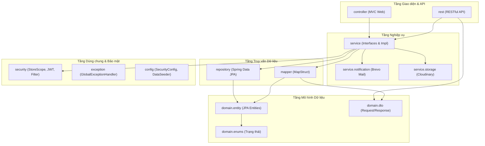

# 03 — BẢN ĐỒ CLASS, METHOD VÀ SƠ ĐỒ PHỤ THUỘC (CLASS & METHOD MAP)

> **Mục tiêu:** Cung cấp bức tranh toàn cảnh về mối quan hệ Dependency Injection, Call Graph giữa các tầng Controller -> Service -> Repository -> Entity.  

---

## 1. SƠ ĐỒ PHỤ THUỘC GIỮA CÁC PACKAGE CHÍNH

---

## 2. MA TRẬN PHÂN CÔNG VÀ CALL GRAPH CÁC PHÂN HỆ TRỌNG ĐIỂM

### 2.1. Phân hệ Quản lý Đơn hàng & Tồn kho (`Order & Inventory`)

| REST Endpoint / Handler | Service Method Được Gọi | Repository & Entity Thao Tác | Nghiệp vụ Cốt Lõi |
|---|---|---|---|
| `POST /api/v1/orders/checkout` | `OrderServiceImpl.createOrder(CreateOrderRequest)` | `OrderRepository`, `OrderItemRepository`, `InventoryRepository`, `OrderReservationRepository`, `VoucherRepository` | 1. Sắp xếp SKU tránh deadlock. 2. Kiểm tra tồn khả dụng (`actual - held`). 3. Tìm chi nhánh gần nhất. 4. Tạo đơn & sinh `OrderReservation` giữ tồn kho. 5. Lưu snapshot giá và tên sản phẩm. |
| `POST /api/v1/orders/{id}/cancel` | `OrderServiceImpl.cancelOrder(orderId)` | `OrderRepository`, `OrderReservationRepository`, `InventoryRepository` | 1. Kiểm tra trạng thái đơn có cho phép hủy không (`OrderStatus.canTransitionTo`). 2. Giải phóng tồn kho (`RELEASED`), giảm `held_quantity`. |
| `PUT /api/v1/orders/{id}/status` | `OrderServiceImpl.updateStatus(orderId, newStatus)` | `OrderRepository`, `InventoryRepository`, `OrderReservationRepository` | Khi đơn chuyển sang `DELIVERED`/`COMPLETED`: Chuyển reservation sang `COMMITTED`, giảm `actual_stock` và `held_quantity`. |
| `POST /api/v1/stock-transfers` | `StockTransferServiceImpl.createTransfer(request)` | `StockTransferRepository`, `StockTransferItemRepository`, `InventoryRepository` | Tạo phiếu điều chuyển giữa 2 chi nhánh, trừ tồn kho xuất, cộng tồn kho nhập khi hoàn tất. |

### 2.2. Phân hệ Danh mục & Tìm kiếm Mỹ phẩm (`Catalog & Search`)

| REST Endpoint / Handler | Service Method Được Gọi | Repository & Entity Thao Tác | Nghiệp vụ Cốt Lõi |
|---|---|---|---|
| `GET /api/v1/products` | `ProductServiceImpl.searchProducts(filter)` | `ProductRepository`, `ProductSkuRepository`, `BrandRepository`, `CategoryRepository` | Tìm kiếm mỹ phẩm: Chuẩn hóa tiếng Việt không dấu (`stripAccents`), lọc theo `SkinType` (da dầu/khô), `SkincareNeed`, phân trang `Pageable`. |
| `GET /api/v1/products/{slug}` | `ProductServiceImpl.getProductBySlug(slug)` | `ProductRepository`, `InventoryRepository` | Lấy chi tiết sản phẩm kèm danh sách SKU và tình trạng tồn kho theo từng chi nhánh showroom. |

### 2.3. Phân hệ Xác thực & Phân quyền (`Security & Multi-branch`)

| REST Endpoint / Handler | Service Method Được Gọi | Lớp Bảo Mật Phụ Trách | Nghiệp vụ Cốt Lõi |
|---|---|---|---|
| `POST /api/v1/auth/login` | `AuthServiceImpl.login(LoginRequest)` | `JwtService`, `AuthCookieFactory` | Xác thực mật khẩu BCrypt, sinh JWT chứa claims (`userId`, `role`, `permissions`, `storeIds`), ghi vào Cookie HttpOnly `LUNEA_AT`. |
| `POST /api/v1/auth/otp/send` | `OtpServiceImpl.sendOtp(email)` | `RegistrationOtpRepository`, `EmailServiceImpl` | Sinh OTP 6 chữ số ngẫu nhiên (`SecureRandom`), TTL 5 phút, cooldown 30s, gọi Brevo API gửi mail bất đồng bộ. |
| Mọi request có bảo vệ | `JwtAuthConverter`, `StoreScopeInterceptor` | `StoreScope`, `SecurityContextHolder` | Kiểm tra token, nạp Principal, nạp `storeId` vào `ThreadLocal` để tự động lọc dữ liệu chi nhánh. |
